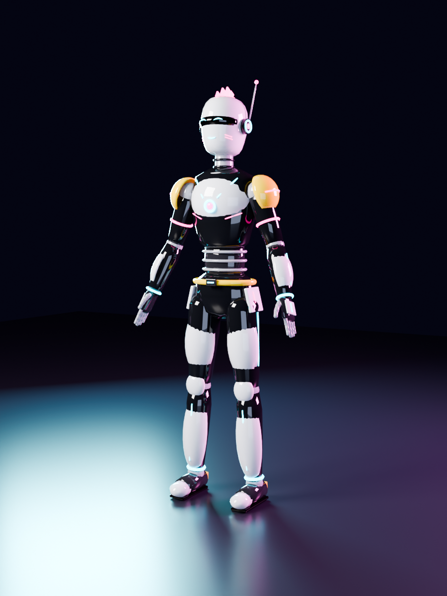
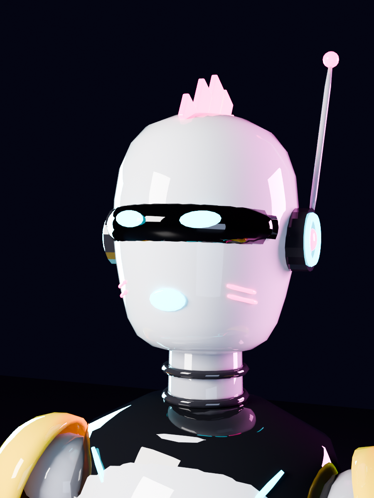
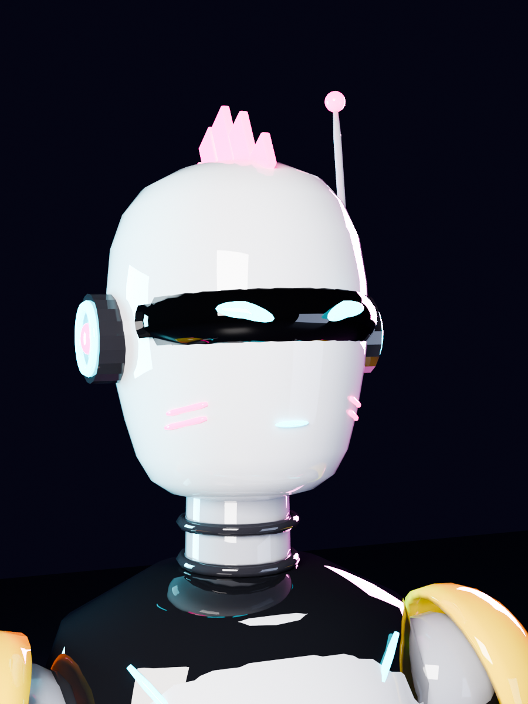

# NEON-7: cyberpunk android avatar for VRChat (PC)

An original avatar built from code: white armor plates over a black suit, a black visor with LED eyes, a glowing LED mouth, a neon crest, and cyan/magenta light strips. All of it comes from `build_avatar.py`, with no hand modelling.



| | |
|---|---|
|  |  |

## What you get

| File | What |
|---|---|
| `output/NEON-7.fbx` | Rigged avatar for Unity. Textures are embedded |
| `output/textures/*.png` | Albedo, Emission, Metallic (R) + Smoothness (A) palette textures, 128 px |
| `output/NEON-7.blend` | Editable Blender file |
| `build_avatar.py` | Generator. Edit and re-run to change anything |

**VRChat PC performance:** 28,700 tris · 1 mesh · 1 material · 54 bones · 0 PhysBones → **Excellent** on every stat.

- **Rig:** Unity humanoid bone names (`Hips`, `Spine`, `Chest`, `UpperChest`, `Neck`, `Head`, `LeftUpperArm`…, all 30 finger bones, `LeftEye`/`RightEye`). It's in a T-pose and 1.89 m tall (to the antenna tip).
- **Shape keys:** all 15 `vrc.v_*` visemes, `Blink`, `Blink_L`, `Blink_R`, `Happy`, `Angry`, `Sad`, `Surprised`.

## Upload it (on your Windows PC)

You need a VRChat account that is allowed to upload avatars (usually the "New User" trust rank or higher) and the **VRChat Creator Companion** (VCC), from vrchat.com/home/download.

1. **Create the project.** In VCC choose *Create New Project*, then *Avatars*. Open it in Unity (VCC installs the right Unity version).
2. **Import.** Drag the whole `output` folder into Unity's *Project* panel (into `Assets`).
3. **Rig.** Click `NEON-7.fbx`, then in the Inspector open the **Rig** tab, set *Animation Type* to **Humanoid**, and click *Apply*. Click *Configure…* if you want to check the mapping. Every slot should be green, including the eyes and all fingers.
4. **Textures.** Select the three PNGs in `textures`. Set *Filter Mode* to **Point** and untick *Generate Mip Maps*, then Apply. The textures are flat color palettes, so mipmaps would blend neighboring colors at a distance. On `NEON-7_MetallicSmoothness` also **untick sRGB**.
5. **Material.** Click the FBX, open the **Materials** tab, and click *Extract Materials…*. On the extracted `NEON-7` material, using the **Standard** shader:
   - *Albedo*: `NEON-7_Albedo`
   - *Metallic*: `NEON-7_MetallicSmoothness`, with *Source* set to *Metallic Alpha*
   - Tick **Emission**. Set *Color* to white (HDR intensity about 1.5–2.5) and the map to `NEON-7_Emission`.
   - *Poiyomi Toon* also works if you prefer it (use the same three maps). Add its bloom/glow for a stronger neon look.
6. **Scene.** Drag `NEON-7.fbx` into the Hierarchy. With it selected, *Add Component* → **VRC Avatar Descriptor**:
   - **View Position:** `X 0, Y 1.69, Z 0.09`. That's between the eyes, just behind the visor.
   - **LipSync:** *Mode* = **Viseme Blend Shape**, *Face Mesh* = `Body`, then click **Auto Detect!**. All 15 visemes fill in.
   - **Eye Look:** Enable it. Set *Left Eye Bone* = `LeftEye`, *Right Eye Bone* = `RightEye`. Under *Eyelids* choose *Blendshapes*, with *Mesh* = `Body` and *Blink* = `Blink` (leave *Look Up/Down* as `-none-`). Keep the eye rotation limits small (about 10°), because the eyes are LEDs on the visor surface.
7. **Upload.** Open *VRChat SDK* → *Show Control Panel*, log in, go to the **Builder** tab, and click **Build & Publish for Windows**. Give it a name and thumbnail, tick the content warning box, and upload. It then shows up under *Avatars → Uploaded* in game.

### Optional: hand-gesture expressions
`Happy`, `Angry`, `Sad` and `Surprised` are ready to use. To trigger them from hand gestures, duplicate the SDK's sample *vrc_AvatarV3HandsLayer* FX controller. In each gesture state (for example *Victory* → Happy, *Fist* → Angry), add a 1-frame animation that sets `Body` → `blendShape.Happy` to 100. Then assign that controller to the descriptor's *Playable Layers → FX*.

## Changing it

Install the Blender Python module (`pip install bpy`, Python 3.13), then:

```bash
python3 build_avatar.py              # rebuild + 5 preview renders (~3 min on 4 cores)
python3 build_avatar.py --no-render  # rebuild only (~4 s)
```

- **Colors:** edit `PALETTE` at the top. For example, swap cyan for green, or make the armor black and the suit white.
- **Shapes:** each body part is a single line in `build_head` / `build_torso` / `build_leg` / `build_arm` (tubes, shells, spheres, boxes).
- Or open `NEON-7.blend` in Blender 4.2+ and edit it by hand.
